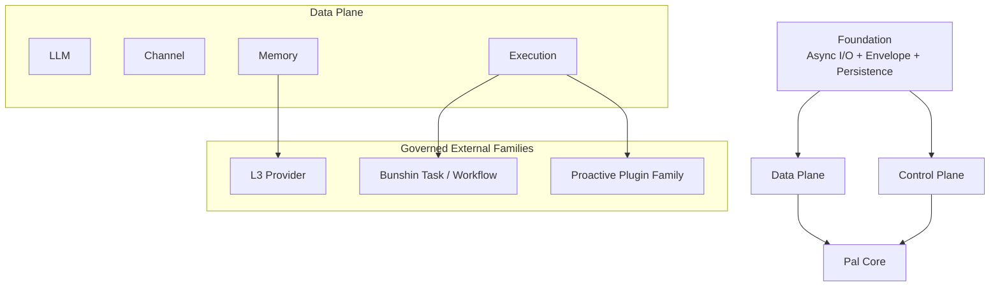
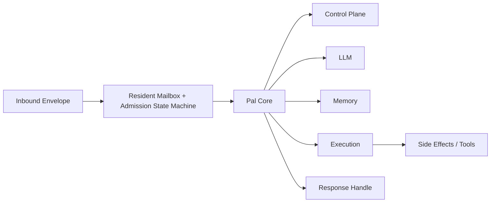

# Pal Architecture Constitution V1

> The architecture baseline began on 2026-04-07; the current implementation boundary was verified on 2026-10-29.
> File names are kept for compatibility with existing links. For specific interfaces, refer to the code and the contracts of the owning subsystem;
> for the current module map, see [Runtime Stack](pal_runtime_stack.md).

## Goals

`Pal` is not a "chat shell + tool list".

`Pal` is:

- an event-driven subject
- a runtime with `Pal Core` as an extremely thin governance center
- an agent system with a unified capability runtime
- a long-lived subject with layered memory
- a governable system with an independent control plane
- a system with constrained self-observation, self-diagnosis, and self-maintenance capabilities

## Overall Layering

### Foundation

Foundation is the lowest layer of the system:

- `Async I/O`
- `Envelope`
- `Persistence`

It provides a safe, reliable, asynchronous, persistable foundation, but owns no domain semantics.

### Data Plane

The resident data plane of `Pal` includes:

- `LLM`
- `Channel`
- `Memory`
- `Execution`

They are responsible for perception, expression, memory, and action.

`Artifact` is an unloadable plugin for managing conversation attachments, not a fifth resident data subsystem.
Channel provides normalized attachments, and Core registers them via the artifact port; the model uses
prompt-safe `artifact_id` values and artifact tools. It differs from ordinary file tools and durable memory.
`shared` provides cross-domain contracts, and `bootstrap` handles assembly; neither serves as a source of domain truth.

### Control Plane

`Control` is an independent control plane and is not part of the data plane.

It is responsible for:

- explicit commands
- approvals
- state transitions
- pause and resume
- user-comprehensible governance actions

### Pal Core

`Pal Core` stands above the data plane and the control plane.

It is only responsible for:

- the event main loop
- minimal control state
- decision-making and scheduling
- cross-subsystem coordination

`Pal Core` is not a state repository, nor a repository of business objects.

## System Invariants

1. `Pal Core` is extremely thin.
2. `Execution` is the only side-effect outlet.
3. `Tool` is the only execution primitive.
4. `Capability` is the semantic capability surface presented to the LLM.
5. `Plugin` provides `Tool`s and registers `Capability`s.
6. `Skill` only provides methodological guidance; it cannot override `Pal`'s own policy, nor inject a new personality.
7. `Control` is an independent governance plane and does not directly handle open-ended reasoning.
8. `L1/L2` is runtime-owned memory; resident recovery stores an encrypted baseline, admission/round journals, and clean-shutdown checkpoints, and Bunshin stores role checkpoints. Recovery of interrupted context does not automatically replay execution.
9. `L3` is an external, pluggable, searchable durable memory engine.
10. `Task`, `Proactive`, and `L3` are all external, but governed.
11. Ordinary channel input shares one resident mailbox, conversation, and execution lifetime; scheduling is governed by the admission state machine. Registered control commands bypass the ordinary turn, and `/btw` uses a temporary isolated branch.
12. The `page_fault` mechanism has been fully replaced by `L1/L2/L3` tiered memory.
13. All subsystems must provide an introspection surface.
14. `Pal` can self-observe, self-diagnose, and self-maintain, but must not cross core identity / policy / constitutional constraints.
15. The user-facing channel must be held by `Pal` itself; the `supervisor` does not proxy normal user messages.
16. A Bunshin/worker never touches users directly and can only communicate with `Pal`.
17. Provider native tool calling is only an external protocol shell and must not bypass local `Execution`.
18. `L1` is the source of truth for the working history, preserving accepted reasoning, the closed tool protocol, and native replay; explicit compaction replaces the frozen LEFT with lossy continuity and preserves RIGHT.
19. `top_of_mind` is only allowed to exist as a hot projection layer and is not durable truth.
20. Terminal states such as `blocked / interrupted / error` must not blindly resume the old execution stack; they can only re-observe and restart based on the current scene.

## Subject Model

`Pal` is a single-subject, single-user, single resident conversation system.

This means:

- Different channels are merely different entry points into the same subject's input stream
- `Pal` does not maintain multiple independent personalities across channels
- The user may clear the context
- The user should not switch to multiple parallel memory conversations

## Core Runtime Model

The runtime abstraction is fixed as:

`EventEnvelope + minimal control state -> Decision -> Capability Invocation -> Tool Effect / Follow-up Event`

## Memory General Principles

`Memory` is an independent subsystem.

- `L1` is the complete working set of the current logical session; after compaction it preserves continuity and history not yet replaced
- `L2` is the hot working set
- `L3` is the long-term durable search engine

Among these:

- `L1/L2` are built into the runtime
- `L3` is an external provider
- Core coordinates compaction and recovery; Memory owns storage and atomic replacement/rollback
- `pal.memory.persistence` owns encrypted recovery; sanitized conversation archives from compact/reset are stored separately
- `Pal Core` does not read or write the memory store directly

## Execution General Principles

`Execution` is the most critical boundary layer in the entire system.

It is responsible for:

- capability registry
- capability routing table
- tool registry
- plugin capability publication surface (code generations and resources are owned by PluginHost)
- introspection index
- validator pipeline
- side-effect dispatch

Any real side effect must go through `Tool`.

## Provider Pattern General Principles

Two kinds of provider patterns exist inside `Pal` and must not be conflated:

### 1. Request Routing and Retry

Providers must obey the retry semantics of their own domain and must not share an implicit fallback assumption:

- `llm` only retries the currently selected endpoint and does not automatically fall back across endpoints; provider, wire shape,
  auth/access profile, and transport are configured separately.
- `web_search` has its own provider selection and fallback chain.
- `web_fetch` is a plugin that manages stateful browsers/sessions, not a general-purpose HTTP fallback registry.

LLM model hooks and response hooks both belong to the LLM protocol adaptation boundary, not the Core event bus.
Provider-native tool calling must still go through the common decode, Core, and Execution.

### 2. Indexing and Persistence Backend

Changes to the embedding provider/model/revision/text-processing affect index consistency,
and must be handled through explicit plan/migrate and generation validation; the embedding space must not be switched ad hoc within a single request.
L3 provider lifecycle and embedding-space migration are different operations.

See [LLM](pal_llm_contract.md), [Web Search](pal_web_search_contract.md),
[Memory CLI](pal_memory_cli.md).

## Control General Principles

`Control` is the built-in governance plane.

It handles:

- slash command
- worker approval request
- system control signal
- mode switch
- explicit pause / resume / cancel / approve

`approve` is a built-in control capability.

## Self-Maintenance General Principles

`Pal` supports:

- self-observation
- self-diagnosis
- self-improvement planning
- controlled self-repair

But by default it does not allow:

- Modifying itself casually in unrelated conversations
- Making structural changes that cross the approval boundary
- Overriding core policy, identity, or the persona contract

## Non-Goals

The following are not goals of this architecture version:

- Multi-agent parallel personality systems
- Multiple users sharing one `Pal` principal
- Treating the searchable dialogue archive as a substitute for encrypted working-state recovery
- Continuing to keep `page_fault`-style silent recall mechanisms
- Making `Skill` an execution layer or personality injection layer
- Letting `Pal Core` directly own task, proactive, worker, and memory durable state

## Subsequent Documents

The subordinate documents of this constitution are:

- `pal_runtime_stack.md`
- `pal_bootstrap_and_process.md`
- `pal_execution_contract.md`
- `pal_introspection_contract.md`
- [Bunshin Task/workflow](bunshin_contract_orchestration.md) (the old tasking contract is kept for historical reference only)
- `pal_proactive_contract.md`
- `pal_control_plane.md`
- `pal_memory_contract.md`
- `pal_failure_reporting_contract.md`
- [Historical migration map](archive/migrations/pal_migration_map.md)
