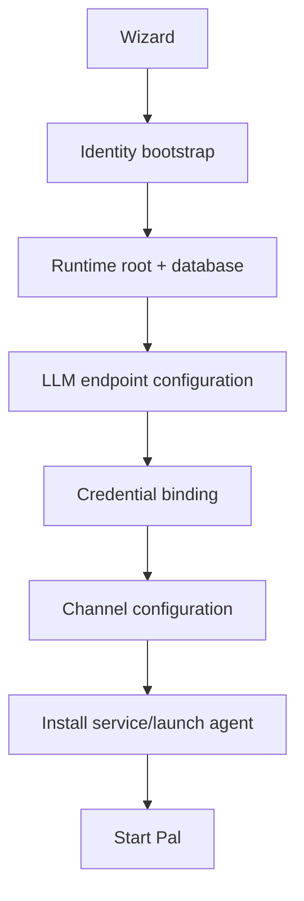

# Pal Bootstrap And Process Contract

This document defines the process relationship between setup wizard,
supervisor/service management, Pal, and workers. It also documents the minimum
first-install bootstrap flow.

## Goals

The bootstrap contract keeps the existing lifecycle boundary:

```text
supervisor/service -> pal -> worker
```

and folds first-install setup into one guided path:

- local identity
- runtime root
- database initialization
- model endpoint configuration
- provider credentials
- channel configuration
- service install/start

## Core Conclusion

Pal has two startup surfaces:

- the user-facing setup wizard
- the long-running supervisor/service layer

They are complementary:

- the wizard owns first-run configuration
- the service layer owns long-running startup, restart, and monitoring

## Process Relationship

The core process relationship is:

- `supervisor/service -> pal -> worker`

Allowed expansions:

- `pal -> worker`
- `worker -> worker`

Hard boundary:

- user-facing channel ownership belongs to `Pal`
- worker communication with the user must route through Pal
- workers do not own direct user channels

## Supervisor / Service Responsibilities

Setup and the supervisor registration layer prepare the runtime root, database
and migrations before the runtime starts. The OS service manager does not run
the wizard or recreate missing configuration. Its responsibilities are:

- registering and supervising a prepared Pal instance
- preserving the Pal launch command
- starting Pal
- restarting Pal after crashes
- reestablishing local process/control associations

It does not own:

- normal user message routing
- channel semantics
- memory policy
- LLM routing policy
- tool execution

On Linux this may be represented by a user systemd service. On macOS this may
be represented by a launchd plist. The contract is service-manager agnostic.
Generated systemd units use `KillMode=mixed`: SIGTERM reaches Pal first so it
can retire owned plugins and sidecars in lifecycle order; systemd still sends a
final SIGKILL to any process left in the cgroup after the stop deadline.

## Pal Responsibilities

`Pal` is the single foreground agent process.

It owns:

- channel endpoints
- normalized user input
- the main turn loop
- prompt assembly
- memory / LLM / execution / control coordination
- worker/bunshin spawning and observation
- final user-visible replies

## Worker Responsibilities

Workers and bunshins own delegated work. They may:

- perform task-specific execution
- write workspace artifacts
- report progress through manager IPC
- request approval through Pal
- emit terminal events through Pal

Workers must not:

- bypass Pal channels
- mutate Pal governance directly
- recursively expose Pal's full capability registry unless explicitly scoped

## Wizard Responsibilities

The setup wizard collects enough information to create a runnable local Pal
instance.

Minimum configuration:

1. Identity
   - Pal display name
   - primary user label
   - locale/timezone defaults when available
2. Runtime root
   - target directory
   - database path
   - log/output paths
3. Model endpoints
   - provider
   - model id
   - API mode / adapter hints
   - base URL
   - priority
   - capabilities such as tools, streaming, reasoning, and vision
4. Credentials
   - auth kind
   - credential reference
   - keychain or provider-local auth material
5. Channels
   - channel kind
   - endpoint id
   - binding/auth material
   - enabled state
6. Service install
   - service/plist path
   - launch command
   - working directory
   - log path

Credentials should be stored through the configured credential mechanism, not as
plain text in repository files.

## Recommended Bootstrap Flow



## Current Implementation Alignment

Current code entry points:

- setup wizard CLI: [wizard/cli.py](../src/pal/wizard/cli.py)
- setup wizard runtime: [wizard/runtime.py](../src/pal/wizard/runtime.py)
- CLI entrypoint: [main.py](../src/pal/main.py)

The current wizard line covers:

- identity bootstrap
- LLM endpoint rows
- endpoint-local API credentials and supported OAuth authorization
- channel selection plus an always-provisioned recovery socket
- memory embedding preferences
- policy/config generation
- database initialization

## Runtime Composition

`compose_runtime()` is responsible for constructing a runnable Pal runtime from
repositories, services, providers, and plugins.

Composition should:

- instantiate first-party module services
- register builtin providers
- load configured runtime providers
- publish selected capability subtrees
- attach enabled endpoints
- expose control/introspection surfaces

Shutdown should be explicit. Runtime handles and module handles should provide
stop hooks where they own background processes, IPC clients, watchers, or
sidecars.

## Recovery Principles

### Pal Crash

The service layer restarts Pal. Pal reloads runtime root state, reconnects to
configured channels, republishes capabilities, and resumes from durable stores.

Resident Pal maintains an encrypted atomic baseline plus an encrypted incremental
journal. Accepted L submissions and completed rounds persist state; completed
rounds include the closed R tail, including the final text reply. Streaming chunks
do not each trigger disk writes. The single writer synchronizes committed bytes
and preserves output files needed by the last durable state. Save failure leaves
RAM progress intact, reports degradation and retries at a later boundary.

On SIGINT/SIGTERM, Pal stops admitting turns and publishes a complete baseline
without calling an external model. The next process restores before starting
channel endpoints, marks active turns interrupted and rebases the normalized
state; it retains a recovery point during its lifetime. Tools are not replayed.
The current incomplete round and progress made during storage degradation may
still be lost after SIGKILL, power loss or OOM. Interrupted tool side effects
require observation and reconciliation, not automatic retry.

`pal.memory.persistence` owns both encrypted recovery and the separate searchable
history. Compact/reset archive only dialogue removed from L1 as credential-redacted
daily JSONL under `data/conversation-history/`, by message date in Pal's timezone.
Startup, shutdown and midnight do not append current working dialogue. Compact
attaches file/time references; corrections use conversation/message identity.
Legacy current/compact files migrate only at an archive boundary. Archive-write
failure does not invalidate encrypted recovery. Invalid complete journal records
fail restoration rather than being silently replaced by later normal saves.
See [Memory persistence](pal_memory_contract.md) for format and failure boundaries.

### Worker Crash

Pal or the relevant manager sidecar records the failure and updates the
Task/workflow and role-assignment state. Its recovery policy determines whether
to retry, request user input or report a terminal failure.

## Invariants

- Pal is the only user-facing foreground agent.
- Workers do not own channels.
- First-run setup should produce a runnable runtime root.
- Provider credentials are write-only configuration from Pal's perspective.
- Service install is platform-specific; the lifecycle contract is not.
- Crash recovery reads durable runtime state instead of relying on in-memory
  process state.

## Non-Goals

- This document does not define channel-specific UX.
- This document does not define every bunshin profile.
- This document does not require one universal service manager.
- This document does not define UI screens beyond the bootstrap data contract.
