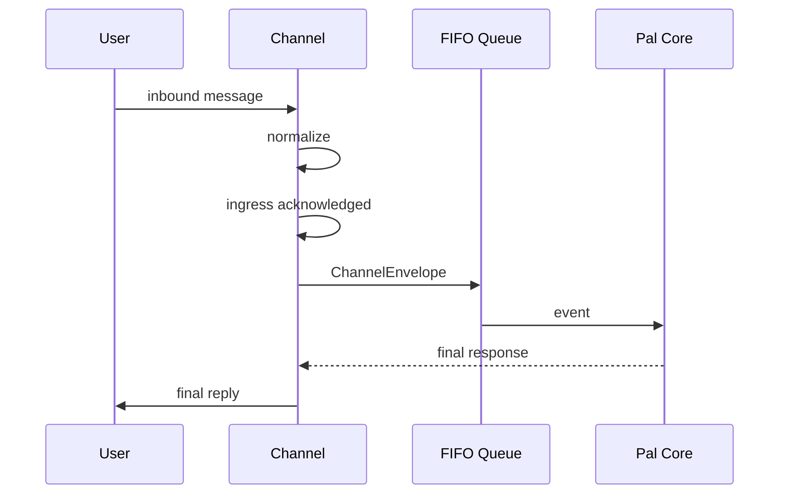

# Pal Channel Contract

> Goal: define the responsibilities and interaction contract of the `channel` subsystem, plus the ingress acknowledgement UX in IM scenarios.

## Goals

The `channel` subsystem is responsible for:

- receiving external input
- normalizing input
- creating standard envelopes for `Pal Core`
- sending final replies according to channel rules
- maintaining user-comprehensible receiving and processing feedback
- providing channel-owned interaction realization

It is NOT responsible for:

- agent reasoning
- memory logic
- capability execution
- control decisions
- letting Core/Control decide a platform's interaction UI (realization is owned by the channel provider)

## Owns

- inbound receive
- inbox / poll loop
- normalize
- endpoint lookup
- response routing
- segmented send
- typing / status feedback
- ingress acknowledgement UX
- interaction rendering and callback normalization
- optional ingress / egress delivery log
- provider lifecycle for channel endpoints

## Does Not Own

- prompt assembly
- llm provider invocation
- memory lifecycle
- capability routing
- tool execution
- conversation-owned durable route state
- platform-specific behavior in `Pal Core`

## Attachment Ingress

Channel endpoints may normalize incoming platform attachments into `payload.attachments`.

Rules:

- The endpoint may download/cache platform bytes when required by the platform.
- The endpoint must not decide prompt exposure or LLM serialization.
- The endpoint must not expose platform callback/file details beyond normalized metadata.
- `PalCore` hands normalized attachments to `pal.artifact`.
- After registration, inner layers use `artifact_id` and artifact tools, not channel-specific file handles.
- In-process endpoints using `ArtifactIngestor` preserve its typed
  `StoredArtifact` result through core ingress when ownership should transfer;
  flattening it to a dictionary intentionally downgrades the source to borrowed.

For the full managed artifact lifecycle, see [artifact_manager.md](artifact_manager.md).

## Simplified Conclusion

The unified shape of `channel` in the new architecture should be kept as simple as possible.

It only needs to:

1. receive messages from the external world
2. normalize them into a unified `ChannelEnvelope`
3. deliver them to the mailbox
4. route replies/status through the envelope's response handle, completed by the runtime/endpoint queue

In other words:

- `Pal Core` should not understand platform details such as Telegram or stdio
- `channel` should not, in turn, carry business reasoning
- if ingress / egress logs need to be written, the concrete channel instance should do it itself
- channel route durability no longer needs to be a first-class source of truth in memory or core
- interaction can be a unified concept, but the concrete realization must be left to the channel provider

## Core Objects

### `ChannelEndpointProviderManager`

`ChannelEndpointProviderManager` is the unified entry point that the channel subsystem exposes to core, execution, and LLM.

It is responsible for:

- registering builtin channel providers
- receiving channel extensions installed by PluginHost, and maintaining provider registration and Hub topology
- resolving endpoints to the provider that owns them
- exposing the provider / endpoint introspection capability
- forwarding endpoint attach, detach, restart, and introspection to providers; provider code reload belongs to PluginHost

It is NOT responsible for:

- directly implementing Telegram, socket, stdio, or any concrete platform behavior
- deciding the interaction UI form of a channel
- holding the business meaning of channel secrets
- bypassing providers to directly create platform SDK clients

The recommended mental model is:

- the manager is the unified registry and the LLM-visible management entry point
- the provider is the actual owner of an endpoint
- the endpoint is a persistable, attachable channel instance in the database

### `ChannelProvider`

Each channel provider must own its own endpoint lifecycle and introspection semantics.

A provider should express at least:

- `provider_id`
- `endpoint_types`
- `list_endpoints(context)`
- `attach_endpoint(endpoint_id, context)`
- `detach_endpoint(endpoint_id, context)`
- `restart_endpoint(endpoint_id, context)`
- `inspect_endpoint(endpoint_id, context)`
- `inspect_auth_state(endpoint_id, context)`
- `inspect_backlog(endpoint_id, context)`
- `inspect_health(endpoint_id, context)`

A runtime-root provider can also implement code lifecycle-level `attach(context)` /
`detach(context)`, or call `register_cleanup(callback)` on the build context.
These resources are managed by the PluginHost generation in a RAII fashion; the manager is responsible for wiring the channel
contribution into the resident Hub. Both unloading and graceful shutdown must go through the same cleanup boundary.

These methods return a unified `IntrospectionResult`, but the content of the result is decided by the provider itself.

This rule is important:

- the manager must not assume the endpoint is Telegram
- the manager must not assume the fields of auth/backlog/health
- the manager must not assume the specific side effects of attach/detach
- only the provider knows how to interpret its own endpoint state

### Runtime Provider Layout

A new channel provider uses the ordinary plugin layout:

```text
<runtime_root>/plugins/community/<plugin_id>/
  plugin.toml
  <plugin implementation>
```

The Manifest declares `lifecycle_protocol = "raii.v1",
`requires_ports = ["channel:provider_manager"]` and `[channel] endpoint_types`.
`build_plugin(context)` returns the instance; `start(scope)` returns a
`ModuleHandle` containing `channel_extension=ChannelExtension(provider=...)`.
See [channel plugin contract](../src/pal/channel/README.md) for details.

The following legacy provider layout remains compatible in place; existing files are not required to migrate:

```text
<runtime_root>/channel/providers/<provider_id>/
  provider.toml
  runtime.py
```

`provider.toml` must contain at least:

```toml
provider_id = "example"
entrypoint = "runtime.py"
version = "0.1.0"
enabled = true
reload_modules = []
```

`runtime.py` must export:

```python
def build_channel_provider(context):
    ...
```

`context` contains the runtime root, the provider directory, the manifest, and the boundary objects a channel provider needs, such as the manager/runtime/repository/secret resolvers.

Channel provider code is managed by the PluginHost; ChannelRuntime and EndpointHub are resident.
A new provider declares via the ordinary `plugin.toml` `[channel] endpoint_types`, and provides the implementation through
`ModuleHandle.channel_extension = ChannelExtension(provider=...)`.
The `provider.toml` / `build_channel_provider(context)` above is the legacy format kept compatible in place.

`rescan_plugins` scans metadata and does not automatically import or reload newly added third-party providers.
Native declarations may establish a Hub at scan time; legacy-format endpoint types are discovered on the first `manage_plugin(operation=attach)`.
`manage_plugin(name=provider_id, operation=attach)` loads the provider and restores endpoints that match the persisted attach intent;
operation=reload performs detach → unload → load → attach.
operation=disable/enable manages the code-enabled state; enabled in legacy manifests is only used for first discovery.
A failed resolution keeps the known provider and is not treated as physical deletion.

Each physical endpoint id has a stable EndpointHub in ChannelRuntime.
Both plugin detach and endpoint detach preserve the Hub and backlog; endpoint detach does not unload the owning plugin.
Only physical deletion of a provider package removes the Hub, transfers pending deliveries to the recovery socket, and keeps the persisted row.
A normal plugin detach/disable is a generation exit, not a physical deletion.
If cleanup fails, the old generation's ownership is retained, parallel loading is blocked, and retry is allowed.
`manage_channel_endpoint(name=endpoint_id, operation="restart")` only rebuilds the transport and does not re-import provider code.

attach is used to restore an explicitly detached endpoint. Repeated attach on a stable already-attached transport
keeps the original instance and returns `changed=false` / `transport_restarted=false` with a side-effect-free receipt;
success only means attached, not connection health. When there is a connection failure, the result provides a conditional health / restart
affordance, and the model decides the next step according to the original task. A broken network connection does not mean the endpoint has been detached.
Core endpoint attach likewise preserves the instance; core endpoint reload routes an existing instance through restart.

The Hub takes over the old endpoint outbox; new replies, streams, statuses, and attachments during transport unavailability
enter the same ordered buffer. Once the new transport can deliver, the Hub enters `draining`, and only after draining in order does it enter
`attached` and publish to the LLM execution registry. detach first revokes the capability, then stops the transport.

1024 items / 4 MiB is an observable soft high-water mark; critical delivery
is not silently dropped for exceeding this threshold. Mergeable ephemeral statuses and adjacent plain-text deltas are
coalesced. Expected lifecycle gaps do not escalate to Safe Mode failure. The queue is kept in-process only;
cross-process restart is an explicit hard boundary, without introducing a persistent queue or complex runtime generations.

### `EndpointConfig`

The current immutable config DTO is defined in
[shared/agent_io.py](../src/pal/shared/agent_io.py), with fields:

- `endpoint_id`
- `channel_kind`
- `binding_key`
- `send_policy`

Enabled/detached state and private binding metadata belong to the persisted endpoint row/transport,
and are not invented fields of this DTO. Length, segmentation, parse mode, and typing rules are interpreted by the endpoint/provider
and must not be placed in Core. `channel_kind` is only used for persisted type matching, not for deciding platform behavior.

### `ResponseHandle`

Immutable routing values with fields `endpoint_id` and `reply_target`; there is no `respond()` or
`set_status()` method. Core enqueues replies, status, streams,
and attachments via the agent I/O/runtime port; the actual sending is done by the endpoint. The immutable
`TurnDeliveryBinding` of the opening message holds this turn's reply authority, and later input on other channels must not steal it.

### `ChannelEnvelope`

Composed of `event: EventEnvelope`, `endpoint: EndpointConfig`,
`response_handle: ResponseHandle`, and an optional `opening_delivery_binding`.
Normalized payload, correlation, and occurrence time live in the event, not as a parallel source of truth on the envelope.

The main loop only handles typed envelopes/events, not raw objects such as Telegram callbacks.

## Unified Channel Interface

Concrete endpoint implementations implement `ChannelEndpointQueueBase`; the main boundaries are:

- `start_async()` / `stop_async()`:transport lifecycle
- `normalize_raw(raw)` / `poll()`: normalization and mailbox ingress
- `queue_reply(...)` / `queue_status(...)` / `queue_stream_update(...)`: accept data pending delivery
- `flush_outbox()` and other flush methods: trigger the actual sending
- `send_reply(handle, text)`: the provider's reply transport hook
- `send_message(message)`: the proactive sending contract
- `inspect_health()` / `inspect_auth_state()`:provider-owned diagnostics

Async SDKs may run within the endpoint's own worker/event loop. Queue acceptance and
actual remote delivery are separate: end of turn does not wait for platform acknowledgment. No invented
`AsyncIterator[ChannelEnvelope]` interface is required here, and routing values are not treated as callable transports.

### Active Message Contract

Proactive messaging and the current turn's reply are two separate contracts:

- The LLM only calls `send_channel_message(channel_id, message)`
- `channel_id` is a configured endpoint id returned by `list_channel_endpoints`
- `ChannelRuntime` is responsible for resolving the endpoint and mechanically checking attached/enabled state
- Inside the endpoint, only `send_message(message)` is received; the recipient is determined by the endpoint's persisted binding
- Provider-specific targets such as Telegram chat ids or WebSocket peer URLs must not appear in LLM input
- An endpoint without a unique default recipient must return `active_send_unsupported`
- `send_reply(ResponseHandle, text)` remains only for replying to an existing ingress turn, and must not be conflated with proactive sending

Proactive sending is a non-idempotent external write. On failure, if the actual send result cannot be confirmed, it must not be retried automatically;
reconcile with the receiving side first. The returned receipt expresses that the endpoint has accepted or completed this send; it does not fabricate
a delivery guarantee that the underlying platform does not have.

## Interaction Contract

Interaction is unified semantics, not unified UI.

Modules such as Core, control, and Bunshin may produce typed interaction intents, for example:

- command list
- confirmation
- approval decision
- lesson decision
- choice action
- status update

The channel provider is responsible for turning these intents into its own platform realization.

For example:

- Telegram may use inline keyboards, callback queries, message edits, reactions, typing
- A socket channel may use structured JSON events
- A CLI / stdio channel may use text menus or command round-trips
- A Web channel may use native buttons, toasts, panels, or forms

The shared constraints are:

- The provider must normalize platform callbacks into typed interaction results
- Core does not receive platform raw objects such as Telegram callback payloads
- Registered slash commands, button callbacks, and menu choices must all be resolved by channel/control into explicit actions before entering core
- `/...` text that matches no registered command or alias should fall back to a plain `user.message`, and must not be truncated by the control path as an unknown command
- The provider may decide how to present things, but must not change the business semantics of an action
- Interaction state, token mapping, message edits, and delivery retries are provider implementation concerns

In other words:

- `interaction` is Pal's internal typed contract
- `inline keyboard` is just one realization of the Telegram provider
- managers should not hard-code any interaction UI
- channel providers must provide their own interaction rendering, status update, and result normalization

### Revision-capable lists and field inputs

InteractionMessageSpec retains the original text/buttons, plus optional revision, items, and inputs.
InteractionItemSpec contains an item ID, title, full body, status, and buttons;
InteractionInputSpec contains an input ID, field name, current value, multi-line flag, and submit button.

The shared projection produces public JSON containing only labels and opaque tokens; action keys, parameters, user identity checks, and submission authorization stay server-side. Clients return interaction_id/button_token, and field submissions additionally carry input_values, whose keys must exactly match the input IDs declared by that token and whose values must be strings. Ordinary buttons must not smuggle field values; after a revision change, old tokens become invalid, and the business service also validates the revision. Arbitrary action parameters from browsers or Telegram must not be treated as authorization.

Telegram projects inputs as persistent ForceReply bound to the chat, thread, and known user; expired inputs are consumed by the control path with a recovery prompt and do not fall back to ordinary chat. TTY and desktop pet submit the full text and must not trim or flatten data. On client send failure, edited content should be preserved and retry allowed; server drafts are recovered via /memory_review. Plain text providers must at least display the full text of the item.

## Tagged Message Contract

Normal user-visible messages may carry optional semantic tags and structured payloads. `text` is always the complete fallback;
providers may enhance tags they recognize, and unknown tags must be delivered as plain text messages. Tags do not belong to status,
control interactions, or LLM deltas, and Core is not allowed to choose platform behavior based on `channel_kind`.

Checklist is delivered with `tag=checklist` as a full snapshot. Telegram may edit one message in place, and desktop clients may project it as a
separate panel, while other endpoints keep sending the same fallback text.

## Main Path



## Ingress Acknowledgement

After receiving a user message and successfully enqueuing it, `channel` should promptly give a lightweight, clear, low-disturbance "received" acknowledgment.

The goal of this acknowledgment is not to reply with business content, but to tell the user:

- the message was received by `Pal`
- it has entered the processing queue
- it was not lost, nor unseen by the bot

## Ingress Feedback Three Stages

The default feedback flow for IM channels is fixed as:

1. `ingress accepted`
2. `processing visible`
3. `final response delivered`

That is:

- give the "received" acknowledgment immediately upon enqueue
- then switch to a typing / processing status
- finally send the formal reply

## Telegram Realization

For IM channels such as Telegram, the default realization is:

1. After the message successfully enters the `Pal` queue, immediately mark the user's message with an `eyes` reaction
2. Then switch to the typing indicator
3. Once `Pal Core` produces the final reply, route and send the finished content according to Telegram policy

The reasons for this are:

- messages sent by the bot itself naturally have double checkmarks and cannot express "whether the user's message was received"
- the eyes reaction is more like a receipt marker rather than an extra noise message
- typing is well suited to express "Pal is processing"
- the final reply stays clean, without temporary confirmation text mixed in
- long replies and complex formats should be safely split by the Telegram-side routing policy

## Why Not Raw Delta Streaming

IM channels by default should not directly carry the provider raw stream.

Reasons include:

- segment length limits
- edit/send rate limits
- Markdown / code block truncation
- flickering of half-finished text

Therefore:

- `llm` may stream internally
- `channel` by default only presents status/typing
- the finished result is then output by `channel` according to the send policy

## Channel-Specific UX Rule

The `channel` subsystem allows defining a separate acknowledgement UX for each IM platform.

But common constraints must be satisfied:

- No extra pollution of the conversation flow
- No pretending that understanding or execution is already complete
- No confusion with formal business replies
- No replacement of typing/status

Telegram's `eyes` marker is one channel-specific implementation of this, not a globally mandated UI.

## Segment Send Rule

Once the final reply has been formed, the `channel` should decide according to endpoint policy:

- Send in a single message
- Send in multiple segments
- Whether code blocks need to be split
- Whether truncation and reassembly are needed to fit platform limits

This step happens at the final reply stage, not at the provider streaming stage.

More generally:

- If a channel's output side has a per-message size limit
- Or has strict format integrity requirements

Then that channel must own its own response segmentation logic.

In other words, the decision of whether to split should not be hardcoded in `Pal Core`, but should be determined by channel policy.

The recommended configuration source is the endpoint's `send_policy.max_message_chars`.

### Telegram Segmentation Rule

Telegram should use channel-owned response segmentation by default.

That is:

- `Pal Core` produces a unified final response
- The `channel` is responsible for splitting it into safe message segments according to Telegram limits
- Each segment after splitting still belongs to the same formal reply, not a new business event

The Telegram splitting strategy should consider at least:

- Per-message length limits
- Markdown / code block integrity
- Not breaking lists or quote blocks in the middle
- Splitting at semantic boundaries where possible, rather than mechanically truncating by character count
- The send order of multi-segment messages must be stable

Recommended behavior:

- Prefer splitting at paragraph, heading, and code block boundaries
- Put overly long code blocks into their own segment
- If necessary, retain a minimal context hint in subsequent segments

This avoids:

- Telegram truncating messages halfway
- Unclosed code blocks
- Disordered ordering of multi-segment replies
- Users mistaking them for multiple independent replies

## Current Telegram Implementation Alignment

The Telegram adapter implementation in the current repository is located at:

- [runtime.py](../providers/telegram/runtime.py)
- [endpoint.py](../providers/telegram/endpoint.py)

The current dependency is located at:

- [pyproject.toml](../pyproject.toml)

The current implementation explicitly depends on:

- `python-telegram-bot>=20.7,<22`
- `telegramify-markdown>=1.2,<2`

The current Markdown rendering path is:

1. After the Telegram endpoint receives the terminal complete text, it converts Markdown into plain text and typed entities
2. It splits the entities according to Telegram's UTF-16 length limits and independently generates well-formed MarkdownV2 for each segment
3. It sends all segments in order via the endpoint's ordered send chain
4. If a segment's MarkdownV2 send fails, only that segment falls back to plain text

This means:

- The Telegram output format is itself a channel-owned concern
- The segmentation logic should also remain the responsibility of the Telegram endpoint/provider itself
- inline keyboards, callback tokens, and message edits also belong to the Telegram provider realization

## Logging Boundary

If channel ingress / egress logs are needed, they should be handled by the channel instance itself.

For example:

- raw inbound message receipts
- response send attempts
- segmentation outcome
- status/receipt marker failures

Ownership of these logs is a channel implementation concern, not a `Pal Core` concern.

The significance of this boundary is:

- prevent core from understanding Telegram/stdio sending details
- prevent memory / tasking from carrying channel delivery context
- preserve each channel's autonomy in handling its own platform characteristics

## Telegram SDK Helper Conclusion

- `python-telegram-bot` handles Telegram API interaction and ordered sending.
- `telegramify-markdown` handles Markdown parsing, typed entity projection, and entity-safe splitting.
- When to settle the complete reply, the segmented sending order, and per-segment failure fallback remain held by the Telegram endpoint.

## Invariants

- `channel` only does I/O, normalize, route, interaction realization, and UX feedback.
- `ChannelEndpointProviderManager` is the unified entry point, not the owner of platform behavior.
- Each provider owns its own endpoint lifecycle, attach/detach/restart, and introspection.
- `ChannelEnvelope + ResponseHandle` is the unified interface between the channel and the main loop.
- Interaction is a typed contract; the concrete UI realization is decided by the channel provider.
- `channel_kind` is the endpoint persistence discriminator, not a basis for core to infer platform behavior.
- After ingress is accepted, receipt-like feedback must be given as soon as possible.
- IM channels default to the three-stage UX of `receipt marker -> typing -> final reply`.
- Telegram uses `eyes` as the default ingress receipt marker.
- Any channel with a per-message output limit must implement its own response segmentation.
- By default, Telegram final replies are routed by the channel itself according to platform rules.
- Channel ingress / egress logs, if needed, are recorded by the channel instance itself.
- Raw provider streaming does not go directly into channel user output.
- Only the final reply is the formal input to channel send.

## Non-Goals

- Do not define Telegram API details in this document
- Do not define concrete reaction/typing SDK calls in this document
- Do not define UI styling in this document
- Do not let `channel` perform business interpretation or agent reasoning
- Do not let the manager hard-code the interaction realization of any particular provider

## Core State Observation

Channels subscribe to the Core bus rather than owning system states like sleeping. Through
`on_runtime_state`, the latest snapshot is projected to the endpoint; through the optional `on_core_event`,
ephemeral notifications are projected. Both only enqueue and do not perform blocking I/O, and do not enter normal delivery failure recovery or history.
See [Core system observations](pal_core_events.md) for the full events and plugin subscription conventions.

## Typing lifetime

Typing is a per-destination aggregate, not one loop per turn. Telegram maintains
one loop for each `(chat_id, thread_id)` and a set of active operation IDs. START
adds an ID; END removes it. Duplicate events are idempotent, overlapping turns or
control operations share the loop, and the last END stops it. A late END cannot
remove another operation. Telegram receives the corresponding message thread ID.

The turn subscriber remembers the START route so an END missing its endpoint or
thread can still release the original owner. Tracked continuation tasks own their
paired events; direct continuations emit their own pair, including on failure or
cancellation. Control operations have independent IDs. Reconnection buffers may
coalesce duplicate statuses only for the same owner. Missing-endpoint statuses are
logged; endpoint shutdown cancels all remaining typing loops.

A transient chat-action delivery failure is logged and retried at the normal
interval while owners remain. It does not count as an END or affect model work.


### Checklist completion delivery

The final `complete_checklist_step` and a fully completed `upsert_checklist` close the
local cursor atomically and declare one independent `channel_event` with
`tag=checklist`, `action=clear` and `active=false`. Core routes it through the same
ordered message/stream queue as display updates, independently of echo text limits.
The complete snapshot remains in the tool result;
closure is not an extra verification requirement. Telegram unpins and deletes
its tracked checklist message. Explicit `active=false` also retires legacy check
messages. A missing tracked message is a no-op, not a new chat notification.
Delete failures preserve the target for existing channel delivery retries.

Active checklist echoes display at most eight steps near the first unfinished
step, with each step shortened to 160 characters and omitted counts shown. This
presentation limit does not shorten the stored plan or `read_checklist` result.
Clear events carry no plan or completion markdown, so a long checklist cannot
suppress cleanup. Channel control metadata stays out of the LLM-facing text.

## Silent Output

The built-in `null_channel` plugin provides an endpoint named `null` that accepts reply, stream, status,
attachment, and interaction and silently discards them, creating no transport I/O, callback state, or replay.
On load it only creates the default row when the endpoint does not exist; reload preserves the existing enabled/detached state.

A silent proactive task uses
`set_proactive_destination(name=TASK, out_channel_name="null")`.
the string `"null"` to select the sink, while JSON null clears the destination; the two are different.
Run history and the execution/approval boundary are still preserved; the sink cannot provide a review UI.
The recovery socket has a finite buffer, ACK timeout, and unconfirmed frame replay, and cannot substitute for `/dev/null`.

## Tool Activity Presentation

Desktop-avatar turns can show an ephemeral tool workspace below the checklist:
actual tool names, folded arguments, execution status, and structured `edit_file` /
`write_file` diffs. Native shell sessions still running appear as background work.
This optional channel projection does not alter tool results, approvals, result
paging, or conversation history. It retains at most 100 calls per turn; argument
and diff previews are limited to 8 KiB and 64 KiB respectively. Explicit sensitive
argument keys are redacted in the display copy; arbitrary text and diffs are not
secret-scanned. The workspace clears when the turn ends. The matching updated
`desktop_avatar` provider and client are required; other channels are unchanged.
