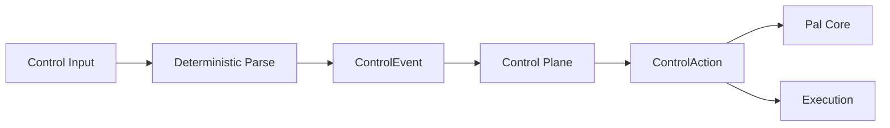
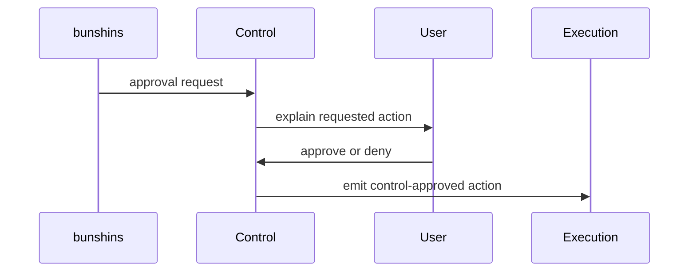

# Pal Control Plane

## Current Implementation Alignment

Registered slash commands are deterministic control-plane ingress. When the slash command name resolves to a registered control command, it bypasses LLM reasoning, prompt assembly, and L1 transcript writes. If a `/...` text does not match any registered command or alias, Control re-emits it as a normal `user.message`; the text then follows the ordinary conversational LLM path instead of producing an "unknown command" reply. Registered commands with invalid arguments are still handled as control errors.

The command parser accepts both direct command text and Telegram bot-addressed command text:

- `/control`
- `/control@PalDevBot`
- `/refresh_llm_endpoint`
- `/refresh_llm_endpoint@PalDevBot`

The optional `@BotName` suffix is stripped before command lookup.

`/refresh_llm_endpoint` is a built-in control command. It refreshes LLM endpoint topology from the local database for future turns. It is available in the textual `/control` list, the Telegram command catalog, and the inline control panel as `Refresh LLM`.

`/model` switches endpoints only between turns. Active turns, unfinished teardown,
pending input, compaction, and maintenance reject the switch immediately. Selecting
the current endpoint opens its thinking menu and explicitly resumes a paused
subscription, as before.

Selecting a different endpoint creates a source-scoped, 60-second draft. Pal checks
the actual L1 replay and the target context budget. Incompatible replay or oversized
history opens a Compact confirmation before the thinking menu, warning that summary
loss may reduce task performance and that rebuilding the target cache may cost more.
The text equivalents are `/model confirm <token>`, `/model think <token> <level>`,
and `/model cancel <token>`. Reopening the model list or selecting another model
invalidates the old draft; reset and endpoint refresh invalidate all drafts.
The model list, Compact confirmation, and thinking menu update the same control
panel. Back restores that model list; completion and expiry clear its keyboard.
Draft and stage revisions reject callbacks from an earlier selection step.
When Compact is unnecessary, the thinking menu says the current history is
compatible. After confirmation, it says Compact will run once a thinking level
is selected.

Submitting a thinking level rechecks idle state, endpoint metadata, and history.
When needed, the same compaction engine as `/compact` runs on the old endpoint.
One admission ticket holds incoming messages until Compact and the model/thinking
settings commit finish. Failure keeps the old selection and resumes normal input;
a summary already committed remains in effect and is reported. The agent has no
`set_active_llm_endpoint` tool. `/llm_fallback` and `/fallback` are removed.

/memory_review [batch_id] restores a host-owned memory proposal batch on its bound endpoint. Each candidate is marked or edited separately; only the final batch-submit action authorizes writes. Editing, navigation, retries and field replies remain deterministic control traffic outside L1 and conversational LLM requests.

The control panel includes **Memory proposals**. Review cards show one candidate at a time with **Accept**, **Reject**, and **Edit**. Accept/reject advances to the next pending candidate; editing affects only the displayed candidate and saving returns to it for confirmation. Reopening resumes at the first pending candidate. After all decisions, a compact final review offers batch submission and individual revisit buttons. Every card includes the exact recovery command. Review interface labels and validation messages are English; candidate content retains its original language. Telegram providers must support interaction `items`, revision tokens and input forms; updating resident Pal alone leaves older installed providers unable to render candidate bodies and buttons. Update and reload the Telegram provider as well.

Inline control buttons should use typed actions. Generic command buttons use `control.command.run` with `command_name`; arbitrary module-specific actions use `control.action.dispatch` and carry a typed `ControlAction` payload. Channel endpoints own platform-specific rendering such as Telegram inline keyboards and callback tokens.

> Goal: define the responsibilities, boundaries, and interaction contract of `control`.

## Goals

`Control` is the independent control plane of `Pal`.

It is responsible for enabling users, Bunshin/workers, and the system to govern `Pal` through an explicit and comprehensible approach, instead of throwing all commands into open-ended agent reasoning.

## Position

`Control` is not part of the data plane.

It sits:

- above `Channel`
- outside `Execution`
- beside `Pal Core`

It provides `Pal Core` with deterministic control actions, rather than free reasoning results.

## Owns

- explicit command semantics
- approval semantics
- governance actions such as pause / resume / cancel / approve
- bunshins permission handoff
- system control signal normalization
- deterministic control parsing

## Does Not Own

- tool execution
- general chat reasoning
- durable state storage
- plugin implementation details
- business object truth

## Input Sources

The inputs of `Control` come from exactly three sources:

- slash command
- bunshins approval request
- system control signal

Optionally, it may also accept:

- explicit user natural-language control sentences

However, once they enter `Control`, they must first be converged into explicit control intents, rather than continuing through open-ended free reasoning.

## Core Objects

## ControlEvent

`ControlEvent` represents a standardized input entering the control plane.

It contains at least:

- `event_id`
- `event_kind`
- `source_kind`
- `payload`
- `response_handle`
- `correlation_id`
- `created_at`

## ControlAction

`ControlAction` represents a governance action produced by the control plane.

It contains at least:

- `action_kind`
- `target_scope`
- `target_id`
- `requires_user_confirmation`
- `delivery`
- `notes`

`delivery` is a typed `ControlDelivery` compiled by `control`, not by `core`.
Its `delivery_kind` is one of:

- `reply`
- `interactive_open`
- `interactive_update`
- `interactive_resolve`
- `interactive_expire`
- `endpoint_status`

The runtime path is:

`channel event -> ControlEventHandler/ControlPlane -> ControlAction -> PalCore dispatch -> channel render`

`PalCore` applies state changes and dispatches typed deliveries. Channel endpoints own platform rendering and fallback behavior.

## Execution Model

## Built-in Control Capabilities

The following capability families must be built-in:

- `control.approve`
- `control.cancel`
- `control.status`
- `control.pause`
- `control.resume`
- `control.mode_switch`

Among them:

- `approve` serves as a governance relay when Bunshin/workers request permissions
- `approve` is not a business tool
- `approve` by default does not directly modify business objects; instead, it releases the execution right of a controlled action

## Approval Object Contract

Behind `approve` stands a formal approval object, not an ephemeral button.

It should at least carry these semantics:

- proposal snapshot
- target identity or target digest
- decision lifecycle
- delivery state
- consumed state

The lifecycle of an approval contains at least:

- pending
- approved
- rejected
- consumed

This ensures that an approval can be understood by users and can also be formally referenced by tasking, Bunshin/worker replacement, and failure reporting.

## System Control Channel Boundary

Control signals from the system layer can be delivered into `Control` by the `supervisor` or other runtime components.

However, this control channel does not carry:

- normal user messages
- normal user replies
- ordinary conversational turn payloads

In other words, the control plane can receive system signals, but must not degrade into a "universal message bus".

## bunshins Approval Flow

## Relationship Between Control and Other Modules

### With Channel

- `Channel` is responsible for receiving and sending
- `Control` is responsible for interpreting explicit control semantics

### With Core

- `Core` consumes `ControlAction`
- `Control` does not perform global coordination on behalf of `Core`

### With Execution

- `Control` does not directly apply side effects
- `Control` produces governed execution grants or state change requests
- The actual effects still go through `Execution`

## Determinism Principles

`Control` takes the deterministic path by default.

This means:

- Prefer command syntax
- Prefer explicit mode switching
- Prefer deterministic parameter parsing
- Avoid handing registered control commands over to open-ended free generation
- `/...` text that matches no registered command is not a control command and should fall back to an ordinary user message

## Invariants

- `Control` is an independent control plane.
- `Control` is not part of the data plane.
- `Control` does not directly perform side effects.
- `approve` is a built-in control capability.
- Bunshin approvals must go through `Control`.
- `Control` takes the deterministic path by default.
- Only slash-like input that matches a registered command or alias is consumed as a control command.
- Unmatched `/...` input must fall back to an ordinary `user.message` and must not be truncated by the control path into an unknown-command reply.
- Approval is a formal object, not a transient UI action.

## Non-Goals

- This file does not define command-line or UI details
- This file does not define specific approval pages
- Do not let `Control` replace ordinary business capabilities
- Do not let `Control` take on open-ended chat reasoning
