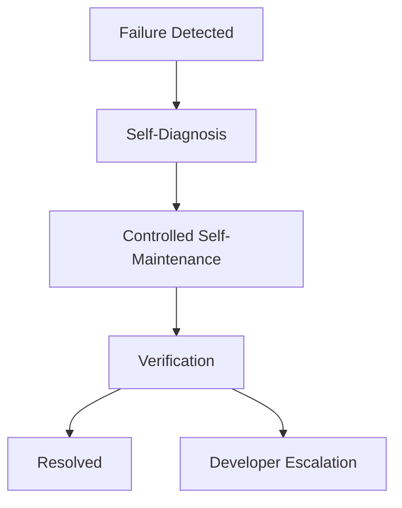

# Pal Failure Reporting Contract

> Goal: turn "what to do when something can't be fixed" into a formal contract.

## Goals

`Pal` is not a black box that only reports errors.

When a failure occurs, the system must escalate along a constrained ladder:

1. self-observation
2. self-diagnosis
3. self-maintenance
4. developer escalation

## Failure Escalation Ladder

## Cases Permitted to Self-Diagnose

The following cases allow `Pal` to go directly into self-diagnosis:

- Subsystem health status is abnormal
- A provider is unavailable
- A plugin fails to load
- The bunshin or proactive flow is blocked
- The memory recall or execution path is abnormal
- Channel delivery fails

## Cases Permitted to Enter Self-Maintenance

The following cases allow `Pal` to create a maintenance task and attempt a controlled repair:

- The problem has been localized to a specific subsystem or provider
- The risk does not touch identity / policy boundaries
- It can be resolved via plugin reload, provider swap, controlled patch, schema repair, or component re-register
- The repair action can be verified and rolled back

## Cases That Must Escalate to Developer Escalation

The following cases must be reported to the developer and cannot continue self-repair:

- The repair action touches core identity, policy, or constitutional boundary
- Introspection cannot localize the problem
- Multiple self-maintenance attempts have failed
- Post-repair verification fails and cannot be safely rolled back
- Durable data may be corrupted
- An architecture-level decision by a human is required
- The repair flow was stopped by `Pal` itself and the problem remains unresolved
- The repair flow was explicitly stopped by `Control` and the problem remains unresolved

## Report Object

The developer report is a structured object, not a casual natural-language complaint.

It must contain at least:

- `report_id`
- `subsystem`
- `component`
- `severity`
- `failure_kind`
- `why_blocked`
- `current_blocker`
- `impact`
- `attempted_actions`
- `evidence`
- `documents_checked`
- `possible_solutions`
- `safe_to_retry`
- `requires_developer_action`
- `recommended_next_step`
- `related_ids`

## Field Semantics

## `report_id`

Unique report identifier.

## `subsystem`

The subsystem the failure belongs to.

Allowed values include, for example:

- `channel`
- `memory`
- `execution`
- `control`
- `tasking`
- `proactive`
- `plugin`

## `component`

A finer-grained component name, for example:

- provider id
- plugin id
- scheduler
- bunshin adapter

## `severity`

It is recommended to fix it as:

- `low`
- `medium`
- `high`
- `critical`

## `failure_kind`

Failure category, for example:

- provider_failure
- routing_failure
- schema_failure
- delivery_failure
- maintenance_failure

## `why_blocked`

A one-sentence explanation of why the flow did not complete this time.

## `current_blocker`

The current minimal but real blocking point.

## `impact`

Describe the scope of impact, for example:

- The current request fails
- A plugin becomes unavailable
- Recall is degraded
- The scheduler is paused

## `attempted_actions`

A list of actions already attempted.

## `evidence`

Structured evidence, for example:

- stack traces
- state snapshots
- health reports
- validation results

## `documents_checked`

Related documents, configurations, logs, or objects that were checked.

## `possible_solutions`

Currently viable next-step candidates.

## `safe_to_retry`

Boolean field indicating whether a safe retry is allowed.

## `requires_developer_action`

Boolean field indicating whether developer handoff is mandatory.

## `recommended_next_step`

The recommended next action for the developer.

## `related_ids`

A collection of related object identifiers, for example:

- `conversation_id`
- `task_id`
- `work_order_id`
- `proactive_id`
- `proactive_run_id`

## Separation of User Feedback and Developer Reports

The system must distinguish between two layers of output:

- User feedback
- Developer report

User feedback requirements:

- Concise
- Understandable
- Explain what has been attempted
- Explain the current blocker
- Explain the suggested next step

Developer report requirements:

- Structured
- Traceable
- Locatable
- Usable for subsequent troubleshooting and post-mortem review

## Relationship with Post-Fix Memory Consolidation

If the problem is successfully fixed, prioritize consolidating system memory rather than generating a developer escalation report.

Only when:

- the problem is still unresolved,
- or the fix process was stopped but not completed,

does the system proceed to formal failure reporting.

## Relationship with Existing Diagnostics

The diagnostics structure currently in the repository can serve as a starting point, but in the new architecture it must be upgraded into a formal contract rather than a failure summary intended only for rendering.

## Invariants

- Failures must escalate along the self-diagnosis -> self-maintenance -> developer escalation ladder.
- Problems that cannot be self-repaired must be reported to the developer.
- A developer report must be a structured object.
- User feedback and developer reports must be separated.
- Reports must include attempted actions and evidence.

## Non-Goals

- This document does not define the log storage implementation
- This document does not define the specific UI presentation
- Replacing the developer report with a passage of natural language is not allowed

## Model Query Entry Point

The model queries via the unique parameterless indirect tool `inspect_failure()`. The former
`inspect_failure_state` and `list_failure_reports` are no longer published; the internal report generation,
escalation handling, and user feedback flows are unchanged. Queries do not initiate health probes, repairs, or retries.

The fixed snapshot contains the resident report/failure counts, the most recent report ID, the 16 most recent diagnostic summaries,
and the counts of returned and omitted entries. Each entry retains module/component/severity/failure type, cause and blocker, impact,
attempted actions, verification status, whether retry is safe, whether developer handling is required, and the suggested next step.
Summary text is bounded, at most four actions are shown, and truncated fields are indicated via `truncated_fields`.
Raw evidence is not inlined into structured or llm_text in the model result.

The complete current report window is saved as a read-only result snapshot containing JSON, returning
`reports_file.file_path`, format, size, and checksum, and can be searched by report ID using rg/read_file
View evidence, full action, document, candidate plans, and related IDs. The file keeps the .txt
suffix from the result store, with content format explicitly JSON. Copying uses the existing diagnostic redaction rules and does not modify the resident
original report. CapabilityResult explicitly carries snapshot_refs, reusing the existing L1/compact
reference and reclamation mechanism; the path text itself does not constitute a lease, and no independent file retention policy is added.

Diagnostic snapshot materialization belongs to query result storage; the tool is still declared as local_read. When there is no report, no
file is written. When there is no execution storage context, serialization fails, or writing fails, the report summary is still returned
normally, reports_file is marked unavailable, diagnostics.partial is true; do not fabricate
paths and do not stuff raw reports back into the model input. The full record remains in the resident owner.

When FailureRuntime is generated normally, at most the most recent 32 reports are retained, and this tool displays the last
16 of them, not a full persisted history. Not every tool or LLM error generates a report; an empty
list only means no reports are retained, and system health cannot be inferred from it, nor can retries be permitted based on it.

This implementation and test cases await validation in the merge batch; source code changes do not mean the running instance has been activated.
