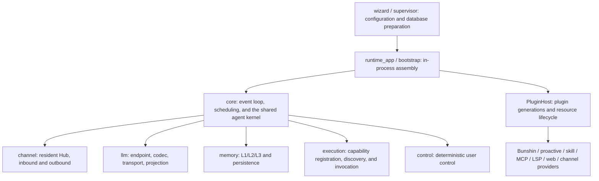

# Pal Runtime Stack

This document describes module responsibilities and assembly relationships based on the current code. The original `tasking` / work-order
skeleton has been replaced by Bunshin Task/workflow; for the historical design, see the [archive index](archive/README.md).

## Assembly Relationships

Arrows represent assembly or coordination relationships, not Python import permission. Cross-domain services communicate through declared ports;
`shared` holds stable contracts, and `foundation` holds low-level infrastructure with no domain semantics.
Specific import constraints are enforced by architectural checks such as `tests/test_import_boundaries.py`.

## Resident and Detachable Modules

The resident modules are `core`, `execution`, `llm`, `channel`, `identity`, `memory`,
`control`, and `failure`. The recovery socket belongs to the resident channel boundary.

Artifact, emotion, checklist, proactive, skill, Bunshin, LSP, MCP, SQLite-vec
L3, web integrations, and `null_channel` are first-party plugins. Optional channel providers
are likewise managed by the PluginHost. The list of built-in plugins comes from `src/pal/plugins_builtin/`;
enabled status and actual mount status must be checked at runtime.

## Infrastructure and Shared Contracts

| Owner | Current Responsibilities | Entry Point |
| --- | --- | --- |
| `foundation` | Low-level facilities such as event envelopes, database connections/transactions, IPC, process and fd leases | [README](../src/pal/foundation/README.md) |
| `shared` | Cross-domain stable contracts, including the sole Tool Protocol IR, agent I/O, and introspection | [README](../src/pal/shared/README.md) |
| `wizard` / `supervisor` | First-time configuration, database preparation, migrations, and service registration | [Bootstrap contract](pal_bootstrap_and_process.md) |
| `bootstrap` | Builds an in-process runtime from an already-prepared database; not responsible for ongoing domain behavior or first-time configuration | [README](../src/pal/bootstrap/README.md) |

`PortKey[T]` declares the assembly key, and `PortRegistry` checks methods and signatures; consumers obtain the current generation via
`PortRef.current`. Do not guess another module's capabilities via reflection, private fields, or catching `TypeError`.

## core

Core owns the event main loop, resident admission, turn continuation, effect dispatching,
prompt assembly, and the `AgentTurnRuntime` shared by Pal and Bunshin. It coordinates runtime-state
snapshot/restore/reset, but does not directly own other domains' databases or platform SDKs.

Resident chat, proactive, and background completion messages share
the admission state machine in [`scheduling.py`](../src/pal/core/scheduling.py).
All normal channel inputs belong to the same resident conversation and execution lifetime;
channels do not create independent personas or session scopes. Recognized control commands bypass the normal reasoning path;
`/btw` uses an isolated temporary branch and does not occupy the resident writer.

Core owns the compaction budget, selection of the frozen LEFT snapshot, retries, validation, and commit ordering.
The shared continuity policy owns the schema, prompts, and full rendering; the host adapter
only retains differences such as task-source, clock, and memory-candidate. Memory is responsible for atomic installation and rollback.

Entry points: [core README](../src/pal/core/README.md),
[turn runtime](turn_runtime_structure.md), [scheduling contract](core_turn_scheduling.md).

## channel

Channel owns normalize, mailbox/outbox, reply routing, attachments, and the platform interaction boundary.
`channel_kind` is the persisted endpoint type discriminator and must not let Core infer UI from it.
Currently `EndpointConfig` contains `endpoint_id`, `channel_kind`, `binding_key`,
`send_policy`; `ResponseHandle` contains `endpoint_id` and `reply_target`.

- `ChannelEndpointProviderManager` registers providers, maintains the Hub topology, resolves endpoints,
  and forwards endpoint lifecycle and introspection.
- PluginHost is responsible for provider metadata discovery, code generation, reload, import eviction, and cleanup.
- The Provider is responsible for concrete endpoint construction, connections, auth/health/backlog, menus, and callback realization.
- The resident `EndpointHub` preserves endpoint identity and the ordered backlog across plugin generation replacement.
  The backlog is in-process; a host restart does not preserve it.

New channel plugins live at `<runtime_root>/plugins/community/<plugin_id>/`, where they
declare `[channel] endpoint_types` in `plugin.toml` and contribute providers via
`ModuleHandle.channel_extension`. The old
`<runtime_root>/channel/providers/<provider_id>/provider.toml` remains compatible in place.

Turn completion only confirms that the reply was accepted by the channel outbox; remote delivery success or failure is a matter of later diagnostics.
The `null` endpoint is the silent drop target; sockets have backpressure, ACK, and replay semantics and cannot substitute for it.

Entrypoints: [channel README](../src/pal/channel/README.md),
[channel contract](pal_channel_contract.md).

## llm

LLM owns endpoint configuration resolution, the canonical request/response IR, codecs, authentication,
HTTP/WebSocket transport, stream assembly, process-local projection, and usage.
Provider, wire shape, auth/access profile, and transport are independent configuration dimensions.

The current request only retries the selected endpoint; there is no automatic cross-endpoint fallback.
Exact-model outgoing hooks only modify messages/tools; provider and exact-endpoint
response hooks run after codec splitting and before the common decoder; they are not the Core event bus.
Only the common decoder produces executable ToolCallIR, and effects still go through Core → Execution.

L1 accepted messages and their replay envelopes are the source of truth for reply replay.
The projection send receipt only proves request admission and does not store a second response authority.

Entrypoints: [llm README](../src/pal/llm/README.md), [LLM contract](pal_llm_contract.md).

## memory

Memory owns the L1 working history, L2 heat/top-of-mind, the L3 provider contract, recall,
and prompt projection. The L3 SQLite-vec implementation is a standalone plugin, not a hard dependency inside Memory.

L1 works in RAM while `pal.memory.persistence` saves an encrypted baseline and the
admission/round journal; a normal shutdown additionally saves a full checkpoint. An unfinished turn is restored
as interrupted context, and tools are not automatically replayed. The relevant state of L2 and Execution is folded into Core-coordinated recovery via their
respective runtime-state ports.

Only compact/reset writes conversations moved out of the working set to
`data/conversation-history/YYYY-MM-DD.jsonl`, partitioned by message date in the Pal timezone.
This desensitized text is not encrypted recovery and does not contain reasoning/native replay.
Embedding space changes go through an explicit plan/migrate, never an ad-hoc fallback within a request.

Entrypoints: [memory README](../src/pal/memory/README.md),
[memory contract](pal_memory_contract.md), [memory CLI](pal_memory_cli.md).

## execution

Execution owns the Capability Forest, immutable registry generations, alias/search
indexes, parameter/result validation, effect/retry semantics, output snapshots, and file permissions.
Core decides mounting and dispatch, Execution performs the concrete invocation; PluginHost owns plugin resource lifecycles.

The model invokes capabilities through unique public aliases; canonical paths and target ids are used only for internal routing.
Schemas that are `DIRECT` or explicitly `native_function` opt-in enter the tool window; other
`INDIRECT` capabilities are used via `search_tools` / `read_tool` / `call_tool`.
The number of capabilities depends on the published registry, not on a fixed singleton count.

Entrypoints: [execution README](../src/pal/execution/README.md),
[execution contract](pal_execution_contract.md), [tool surface](pal_tool_surface.md).

## control, identity, and failure

- Control deterministically resolves registered slash commands, approvals, and typed interactions; it does not do open-ended reasoning.
- Identity owns configured subject profiles and user preferences. `pal identity refresh` updates refreshable fields;
  the system name and core policy are fixed at startup.
- Failure owns fault reporting and governed escalation; inspection must not be treated as implicit authorization to fix.

## Plugin-owned business domains

| Plugin domain | Owned sources of truth and boundaries |
| --- | --- |
| Bunshin | Task, workflow graph, role leases, checkpoints, review, and delivery outbox in a standalone manager/database; not the old work-order API |
| Proactive | definition, schedule, due-trigger mailbox, run history, and output destination; waits for resident admission and uses an isolated context during execution |
| Skill | Searchable and injectable manual/playbook; not execution authority, and no independent behavior advisor |
| Artifact | Lifecycle, representation, and visibility of conversation attachments; distinct from long-term memory or ordinary file tools |
| LSP / MCP | Their respective manager sidecars, external connections, and Pal-native capability projection |
| Web / emotion / checklist | Domain-specific services, presentation, or task guidance; not a replacement for resident governance |

Entry points: [Bunshin](bunshin_contract_orchestration.md),
[proactive](pal_proactive_contract.md), [plugins README](../src/pal/plugins/README.md).

## Activation and Verification

`rescan_plugins` only discovers metadata; newly enabled plugins use `manage_plugin(operation="attach")`,
loaded implementations that changed use `operation="reload"`, and disabled plugins use `operation="enable"`.
Repeated attach preserves the existing instance. Endpoint restart only reconnects and does not re-import the provider.
Only after checking the lifecycle results, load/cleanup errors, and representative behavior can you claim it has taken effect.

Changes to resident/shared Python implementations require the operator or an external supervisor to restart the host.
Do not stop, kill, or schedule a delayed restart of the host from the Pal's own active turn.
For details, see the [builtin manual](../src/pal/skill/builtin_skills.py) in `pal.self.maintenance`.
