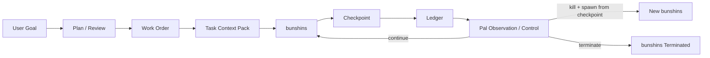

# Pal Tasking Contract

> Historical design, superseded by the current Bunshin contract orchestration. The task/work-order model and tool names below do not represent the current interface. For current tasks, roles, and execution contracts, see [bunshin_contract_orchestration.md](bunshin_contract_orchestration.md); for public tools, refer to [pal_tool_surface.md](pal_tool_surface.md) and the current registry.

> Goal: define `tasking`, `bunshins`, checkpoint, ledger, and workspace governance, and how `Pal` observes and terminates bunshins.

## Goals

`tasking` is the formal subsystem through which `Pal` handles specialized tasks and long-chain execution.

The focus of this version is not to reinvent task subsystem semantics, but to formally strip the already fairly clear task / bunshins / work_order / approval / checkpoint / ledger semantics from the old version out of the `Pal runtime` and consolidate them into a first-party plugin family.

Its significance is not "spinning up yet another executor," but placing work unsuited to direct completion by `Pal` into:

- a clean task context
- a replaceable bunshins execution world
- an inspectable, resumable, and auditable execution chain

## Old Semantics Alignment Principle

`tasking` inherits the core semantics of the old version by default in the new architecture.

The old semantics to be preserved include:

- `Pal` is the principal; bunshins are not principals
- the `supervisor -> pal -> bunshins` process relationship
- bunshins do not contact the user directly; they communicate only with `Pal`
- `work_order` is a formal object, not an ad-hoc execution fragment
- `approval` is a formal object, not an ephemeral button
- continuity binds to `checkpoint / ledger`, not to a single bunshins process
- workspace / branch / artifact are the formal site of task execution

Therefore, what the new version mainly changes in this area is:

- ownership
- registration
- observability
- governance integration

rather than the business meaning of the task subsystem itself.

## Process Model Alignment

The process model already stably established in the old version is retained directly in the new architecture:

- `supervisor` is the lifecycle manager
- `Pal` is the front-control-runtime
- `bunshins` is the execution child

The running relationship is fixed as:

- `supervisor -> pal -> bunshins`

where:

- `supervisor` is responsible for starting, monitoring, and restarting `Pal`
- `Pal` is responsible for interacting with the user, governing tasks, and observing bunshins
- `bunshins` is responsible for executing tasks / work orders

## IPC Plane Alignment

The IPC layering already established in the old version is retained in the new architecture:

1. `supervisor <-> pal`
2. `pal <-> bunshins`

These two chains have different responsibilities and should not be merged into a single "universal message bus."

### `supervisor <-> pal`

This is the control plane / lifecycle plane.

It carries only:

- transport ready
- runtime log
- lifecycle signal
- shutdown / health-like event

It does not carry:

- normal user messages
- normal user replies
- ordinary turn payloads

### `pal <-> bunshins`

This is the execution plane.

It carries:

- planning request
- work order open
- ack / progress update
- checkpoint emission
- done / failed
- process exit

Its transport implementation may be replaced in the future, but the plane boundary itself is treated as preserved semantics.

## Core Principles

- `Pal` governs tasks and does not directly undertake the specialized execution that bunshins should do
- bunshins are replaceable execution actors, not principals
- continuity binds to checkpoint / ledger / workspace state, not to a single process
- the effect surfaces of `tasking` must be exposed through capabilities
- `Pal` must be able to observe bunshins state and must be able to terminate bunshins

## Owns

- task lifecycle
- work order lifecycle
- planning handoff
- bunshins orchestration
- checkpoint continuity
- ledger
- workspace / branch governance
- bunshins state observation
- bunshins termination and replacement

## Does Not Own

- global core governance
- tool execution runtime
- memory ranking
- channel transport
- approval constitution

## Running Model

## Core Objects of Tasking

## Work Order

A `work order` is a formal delegation of execution.

It must be able to express:

- goal
- scope
- plan steps
- acceptance criteria
- verify strategy
- active bunshins
- current status

The old semantics of `work order` are inherited directly in the new architecture.

## Task Context Pack

`TaskContextPack` is the execution context pack sent by `Pal` to bunshins.

It contains at least:

- plan pack
- task-scoped memory
- relevant system-wise memory
- current checkpoint
- workspace info
- branch info
- allowed skills
- allowed tools
- constraints

## Work Order Draft

A work order draft is a planning artifact that precedes the formal work order. It is used to capture the user's brainstorming, module boundaries, candidate milestones, acceptance criteria, and workspace hints.

A draft is not a progress fact, nor a checkpoint. The recommended path is:

- `Pal` drafts the draft from the conversation
- the planner only reviews this bounded draft
- after the user or `Pal` confirms, it is promoted into a formal work order
- at spawn time, a `TaskContextPack` is generated from the formal work order

## Checkpoint

A `checkpoint` is a first-class object for continuity.

It is not an optional log, but the factual record of the milestone cursor.

A checkpoint expresses at least:

- milestone index
- status: completed / partial / blocked
- progress summary
- repo/workspace state summary
- key artifacts
- verification snapshot

`status=completed` advances the derived current milestone. `partial/blocked` only records the on-site state and does not advance the cursor. Do not maintain a second `next_resume_point`.

## Ledger

The `ledger` is the formal bookkeeping layer of tasking.

It is used to record:

- bunshins accepted
- bunshins progress updates
- checkpoint emission
- bunshins kill / respawn
- bunshins termination
- final closeout

The purpose of the ledger is to:

- form the continuity truth
- support recovery and retrospection
- support developer escalation

## Approval

An `approval` is a formal object related to tasking.

It is not a transient UI action, but rather:

- has a proposal snapshot
- has a target
- has a decision lifecycle
- has states such as pending / approved / rejected / consumed

The governance entry point of approval belongs to `Control`, but its task semantics still belong to the tasking domain.

## Workspace / Branch Model

`tasking` by default uses a git-based approximate sandbox environment.

The meaning of "approximate sandbox" here is:

- not operating-system-level isolation
- but constraining the scope of bunshins' changes through workspace / branch / artifact boundaries

tasking must govern:

- workspace location
- active branch
- artifact references
- repo conflict checks

## bunshins Are Replaceable Actors

bunshins are not the principal; `Pal` is the principal.

bunshins must be:

- startable
- replaceable
- terminable
- resumable by taking over from a checkpoint

Continuity is not bound to a single bunshins process.

## Failure And Recovery Semantics

### `Pal` Crash

- the `supervisor` is responsible for starting a new `Pal`
- the new `Pal` re-observes and recovers from durable state and the current on-site state
- blindly resuming the old execution stack is not allowed

### bunshins Crash

- `Pal` detects the bunshins exit via IPC or process exit
- `Pal` decides to report, replace, or terminate based on checkpoint / ledger / work order state
- continuity is still not bound to a single bunshins process

## Tasking Capability Surface

The capability shape currently exposed by the bunshin subsystem to `Pal` is:

- `task_search`
- `task_read`
- `work_order_search`
- `work_order_read`
- `work_order_draft_search`
- `work_order_draft_read`
- `bunshin_list`
- `bunshin_read`
- `bunshin_profile_list`
- `bunshin_profile_read`
- `bunshin_draft_work_order`
- `bunshin_promote_work_order_draft`
- `bunshin_spawn`
- `bunshin_kill`
- `bunshin_finalize`

where:

- `intro_*` allows `Pal` to read tasks, work orders, drafts, profiles, and active runner state
- `bunshin_spawn` is the only launch entry point
- `bunshin_kill` is the normal governance action
- there is no separate replace capability; replacement is `kill` followed by a re-`spawn` using checkpoint continuity

These capabilities are exposed to `Pal`, not to runners. Runners cannot see `intro_*` or `op_bunshin_*`, and cannot recursively spawn new runners.

A runner's capability pool can be inherited from `Pal`'s current capability registry and then filtered, but the LLM-facing tool surface should stay small: expose the discovery/read/call meta-tools, plus a small set of standing work tools (`file_read`, `file_edit`, `file_write`, `shell`, `web_search`, `web_read`, read-only `recall_memory`). Discovery/read must only return capabilities that the runner is already allowed and not filtered out by the blacklist.

## bunshins Observation Contract

`Pal` must be able to observe the minimal state of bunshins:

- bunshins id
- bound work order id
- current status
- last progress update
- last checkpoint
- last heartbeat
- current workspace
- current branch
- pending approval state

## bunshins Termination Contract

`Pal` must own the ability to terminate bunshins.

Typical reasons that allow termination:

- explicit user cancellation
- runaway / hung bunshins
- approval was rejected
- health check fail
- maintenance kill / respawn

After termination, the ledger must be written, preserving:

- termination reason
- latest checkpoint
- restart eligibility

## Relationship to Execution

`tasking` is a first-party plugin family.

This means:

- it plugs into `Execution` via capability surfaces
- its effects still ultimately go through `Tool`
- it is not a private implementation detail of `Core`
- it inherits the semantics of the old task subsystem at the execution level, only changed to plugin-based mounting in the new architecture

## Relationship to Memory

`Pal` should not hand its own chat context verbatim to bunshins.

The correct path is:

- fetch task-scoped memory from the memory subsystem
- fetch relevant system memory
- assemble it into a `TaskContextPack`
- hand it to bunshins

This way, bunshins receives a clean, converged task context.

## Relationship to Control

bunshins approval requests must go into `Control`.

Although bunshins termination and re-spawn belong to the tasking capability, they may still be subject to control governance constraints, especially in cases of:

- explicit user cancellation
- high-risk maintenance
- destructive workspace handoff

## Invariants

- `Pal` is responsible for governing tasks; bunshins are responsible for executing tasks.
- bunshins are replaceable actors, not principals.
- The old semantics of the task subsystem are retained by default.
- continuity binds to checkpoint / ledger, not to a single process.
- `tasking` uses the git-based approximate sandbox by default.
- `Pal` must be able to observe bunshins state.
- `Pal` must be able to terminate bunshins.
- Tasks that are highly specialized, asynchronous, can be converged by SPEC/work order/milestone, and have weak immediate interaction with the user can be suggested by the advisor to enter `bunshin`.

## Non-Goals

- this document does not define concrete git command sequences
- this document does not define the database schema for checkpoints
- this document does not define the bunshins UI
- `Pal` is not allowed to directly execute long-chain specialized tasks in place of bunshins
